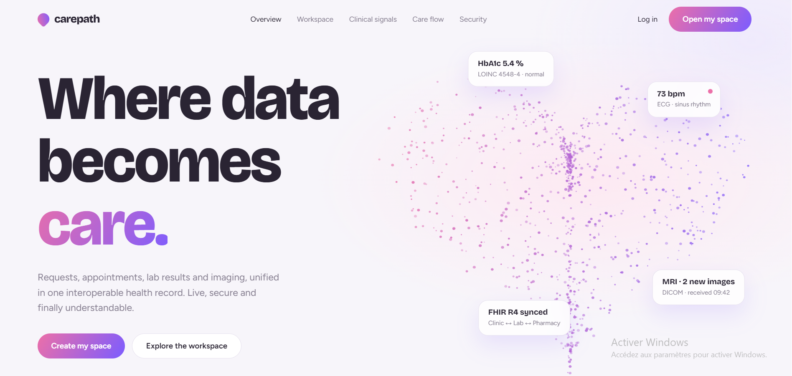
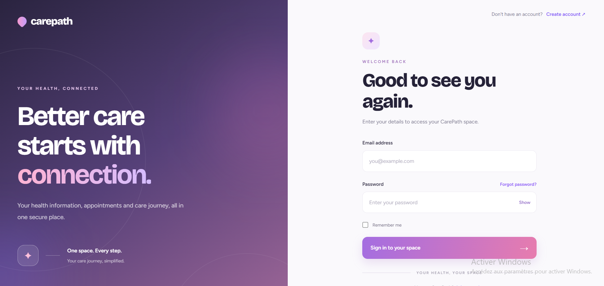
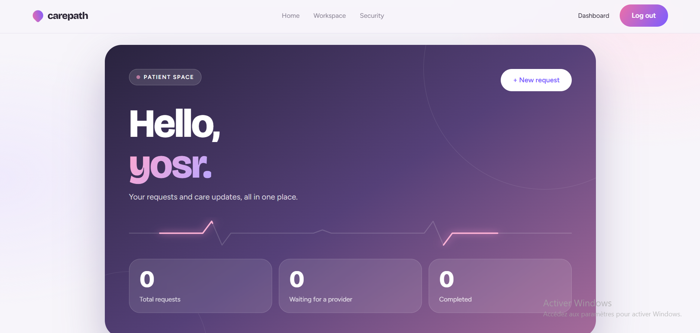
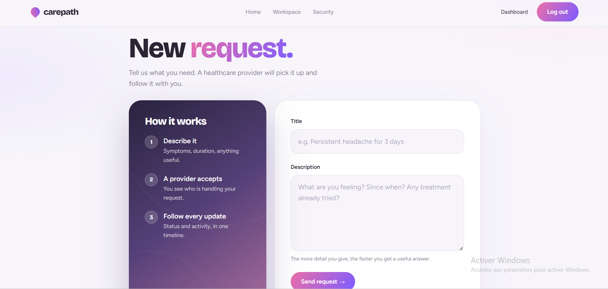

# CarePath
### Healthcare Management Web Application

CarePath is a web-based healthcare management platform designed to connect patients and healthcare providers through a centralized workspace.

The application allows patients to create and track medical service requests, while healthcare providers can review requests, accept them, and manage appointments.

---

## 1. Project Overview

CarePath provides a role-based environment for managing basic healthcare workflows.

### Main Objectives

- Simplify communication between patients and healthcare providers.
- Organize medical service requests.
- Facilitate appointment scheduling.
- Track request progress and important activities.
- Provide a centralized and user-friendly interface.

---

## 2. Features

### Authentication and User Management
- User registration and login.
- Password hashing.
- Patient and provider account roles.
- Role-based route protection.
- Session management.

### Patient Features
- Access a personal dashboard.
- Create medical service requests.
- View request details.
- Track request status.
- View upcoming appointments.
- Follow request activity history.

### Healthcare Provider Features
- Access a provider dashboard.
- View available pending requests.
- Accept medical requests.
- Manage assigned requests.
- Schedule and reschedule appointments.
- Mark requests as completed.

### Request Management
- Create and manage medical requests.
- Track request statuses:
  - Pending
  - Accepted
  - Completed
- Associate requests with patients and providers.

### Appointment Management
- Schedule appointments.
- Reschedule existing appointments.
- Display upcoming appointments.
- Associate appointments with medical requests.

### Activity Logging
- Record request creation.
- Record request acceptance.
- Record appointment scheduling and rescheduling.
- Record request completion.

---

## 3. Technologies Used

| Category | Technologies |
|---|---|
| Programming Language | Python |
| Backend Framework | Flask |
| ORM | Flask-SQLAlchemy |
| Database | SQLite |
| Authentication | Flask-Login |
| Security | Flask-WTF, CSRF Protection |
| Password Security | Werkzeug |
| Environment Configuration | python-dotenv |
| Frontend | HTML5, CSS3, JavaScript |
| Templates | Jinja2 |
| Version Control | Git and GitHub |

---

## 4. Project Structure

```text
CarePath/
│
├── app/
│   │
│   ├── __init__.py
│   │
│   ├── models.py
│   ├── routes.py
│   │
│   ├── static/
│   │   │
│   │   ├── css/
│   │   │   ├── style.css
│   │   │   ├── auth.css
│   │   │   └── dashboard.css
│   │   │
│   │   ├── js/
│   │   │   └── main.js
│   │   │
│   │   └── images/
│   │
│   └── templates/
│       │
│       ├── base.html
│       ├── index.html
│       ├── login.html
│       ├── register.html
│       ├── dashboard.html
│       ├── new_request.html
│       ├── request_detail.html
│       └── _flash.html
│
├── instance/
│   └── carepath.db              # Generated locally
│
├── config.py
├── run.py
│
├── requirements.txt
├── .env.example
├── .gitignore
└── README.md
```

---

## 5. Application Architecture

CarePath follows a modular Flask application structure.

### app/__init__.py
- Initializes the Flask application.
- Configures SQLAlchemy.
- Initializes Flask-Login.
- Enables CSRF protection.
- Registers the main application blueprint.
- Initializes database tables.

### app/models.py
Defines the database models:

- User
- MedicalRequest
- Appointment
- Document
- ActivityLog

### app/routes.py
Contains the application routes and business logic:

| Route | Method | Description |
|---|---|---|
| `/` | GET | Homepage |
| `/register` | GET, POST | User registration |
| `/login` | GET, POST | User authentication |
| `/logout` | GET | User logout |
| `/dashboard` | GET | User dashboard |
| `/requests/new` | GET, POST | Create a medical request |
| `/requests/<id>` | GET | View request details |
| `/requests/<id>/accept` | POST | Accept a request |
| `/requests/<id>/appointment` | POST | Schedule or reschedule an appointment |
| `/requests/<id>/complete` | POST | Complete a request |

### app/static/css/
Contains the styling files:

- `style.css`: Main application and homepage styling.
- `auth.css`: Login and registration styling.
- `dashboard.css`: Dashboard and request interface styling.

### app/static/js/main.js
Contains frontend JavaScript interactions and interface behavior.

### app/templates/
Contains the Jinja2 HTML templates used to render application pages.

### config.py
Manages application configuration and environment variables.

### run.py
Application entry point used to launch the Flask development server.

---

## 6. Database Design

CarePath uses SQLite with Flask-SQLAlchemy.

### Database Models

**User**
- id
- full_name
- email
- password_hash
- role
- created_at

**MedicalRequest**
- id
- patient_id
- provider_id
- title
- description
- status
- created_at

**Appointment**
- id
- patient_id
- provider_id
- request_id
- scheduled_at
- status

**Document**
- id
- patient_id
- request_id
- filename
- uploaded_at

**ActivityLog**
- id
- actor_id
- action
- entity_type
- entity_id
- created_at

---

## 7. Installation and Setup

### Prerequisites

- Python 3.10 or later
- pip
- Git

### Step 1: Clone the Repository

```bash
git clone YOUR_GITHUB_REPOSITORY_URL
cd CarePath
```

### Step 2: Create a Virtual Environment

```bash
python -m venv venv
```

### Step 3: Activate the Virtual Environment

Windows:

```bash
venv\Scripts\activate
```

Linux / macOS:

```bash
source venv/bin/activate
```

### Step 4: Install Dependencies

```bash
pip install -r requirements.txt
```

### Step 5: Configure Environment Variables

Create a `.env` file in the project root using `.env.example` as a reference.

Example configuration:

```env
SECRET_KEY=your-generated-secret-key
DATABASE_URL=sqlite:///carepath.db
```

Generate a secret key using:

```bash
python -c "import secrets; print(secrets.token_hex(32))"
```

Never commit your actual `.env` file or secret keys to GitHub.

### Step 6: Run the Application

```bash
python run.py
```

Open your browser:

```text
http://127.0.0.1:5000
```

---

## 8. Security Considerations

The application includes:

- Password hashing using Werkzeug.
- Authentication using Flask-Login.
- Role-based access restrictions.
- CSRF protection using Flask-WTF.
- Environment-based secret key configuration.
- Exclusion of sensitive configuration and local database files from version control.

---

## 9. Future Improvements

Potential future development includes:

- Automated unit and integration testing.
- REST API development.
- PostgreSQL database integration.
- HL7 FHIR interoperability.
- Medical document upload and management.
- Enhanced healthcare data security.
- Application deployment.

---

## 10. Project Status

CarePath is an ongoing software development project.

The current implementation focuses on authentication, role-based dashboards, medical request workflows, appointment management, and activity logging.

---

## Author

Developed as a software engineering project.

## License

To be determined.

## Screenshots

### Home Page


### Login


### Dashboard


### New Request
